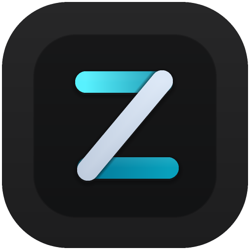

<div align="center">



# FlClashZ

**Mihomo + Zapret для Windows**

[](https://github.com/geliopat/FlClashZ/releases/latest)
[](https://github.com/geliopat/FlClashZ/releases/latest)
[](https://github.com/geliopat/FlClashZ/releases)
[](LICENSE)

[](https://github.com/geliopat/FlClashZ/actions/workflows/zapret-windows-validation.yml)

**Русский** · [English](README_EN.md) · [中文](README_ZH.md)

</div>

FlClashZ — самостоятельный форк [FlClashX](https://github.com/pluralplay/FlClashX), объединяющий прокси-клиент на базе Mihomo и управление Zapret2/Flowseal в одном приложении. Проект ориентирован на Windows x64 и совместимость с Remnawave. Не является официальным клиентом перечисленных проектов.

[Скачать](#скачать) · [Возможности](#возможности) · [Remnawave](#для-провайдеров) · [Обновления](#обновления) · [Сборка](#сборка-из-исходников)

## Скачать

Официальные пакеты FlClashZ публикуются в [GitHub Releases](https://github.com/geliopat/FlClashZ/releases). Ссылки на файлы ниже работают после публикации соответствующего стабильного релиза.

| Вариант | Формат | Ссылка |
| --- | --- | --- |
| Установщик Windows x64 | EXE | [FlClashZ-windows-amd64-setup.exe](https://github.com/geliopat/FlClashZ/releases/latest/download/FlClashZ-windows-amd64-setup.exe) |
| Портативная версия Windows x64 | ZIP | [FlClashZ-windows-amd64.zip](https://github.com/geliopat/FlClashZ/releases/latest/download/FlClashZ-windows-amd64.zip) |

Для обычного использования и встроенного обновления выбирайте установщик. Portable распакуйте в отдельный каталог и запустите `FlClashZ.exe`. Встроенная установка обновления предусмотрена для установленной версии; портативную версию можно обновить вручную.

Целевая платформа — Windows 10/11 x64. Другие платформы унаследованы в исходном дереве, но не являются целью текущих релизов FlClashZ.

## Возможности

| Mihomo | Zapret |
| --- | --- |
| Профили из подписок и файлов, редактор YAML | Встроенное управление Zapret2 и Flowseal |
| TUN, системный прокси, правила маршрутизации | Ручной запуск, остановка и перезапуск |
| Группы прокси, DNS, соединения и логи | Готовые Lua/BAT-стратегии и импорт |
| Автоматические проверки задержек узлов и групп | Автоподбор, история проверок и резервная стратегия |
| Переопределения, скрипты, резервные копии | Диагностика доступности и обновление списков |

### Совместная работа

Mihomo управляет прокси-маршрутизацией и DNS. Zapret применяется в соответствии с выбранным режимом и возможностями стратегии. Режимы STRICT SPLIT и FULL BYPASS, запуск вместе с Mihomo, автоподбор и восстановление настраиваются в приложении или через подписку.

Автоматические проверки задержек используют HTTP(S) URL-тест, а не ICMP. Для балансировщиков отображается результат проверки их участников через ядро. Интервалы активных и остальных подключений задаются в настройках.

### Интерфейс Windows

- Настраиваемый дашборд, карточки, темы, стекло и акриловое меню трея.
- Отдельное управление Mihomo и Zapret; состояние и выбранная стратегия на дашборде.
- Собственные каталоги данных, служба Helper и протоколы импорта, отдельные от FlClashX.
- Подтверждение дисклеймера хранится в каталоге настроек; обновление не требует повторного подтверждения.

## Для провайдеров

Поддерживаются стандартные заголовки подписки Remnawave, HWID и параметры YAML `serverDescription`, `server-description`, `groupDescription` (если панель действительно передаёт их клиенту).

Собственные HTTP-заголовки имеют префикс `flclashz-`. Унаследованные `flclashx-*` читаются для совместимости; новые имена имеют приоритет. Пример:

```http
flclashz-view: app.theme:dark;app.glass:standard
flclashz-widgets: profiles,networkSpeed,networkTakeover,zapret
flclashz-zapret: autostart,mode:fullbypass,autofallback,autotune,tunemode:fast,tuneonfail
```

| Документация | Содержание |
| --- | --- |
| [HTTP-заголовки](docs/headers.md) | Справочник заголовков, ключей и значений |
| [Управление Zapret](docs/flclashz-zapret-headers.md) | Режимы, автоподбор и восстановление |

Для импорта установленным клиентом:

```text
flclashz://install-config?url=<URL-кодированная ссылка на подписку>
```

## Обновления

Стабильные релизы имеют теги вида `v1.0.1`. Проверка обновлений по умолчанию использует подписанный [manifest.json](https://github.com/geliopat/FlClashZ/releases/latest/download/manifest.json) из Latest. Манифест содержит версию, ссылки на пакеты, SHA-256 и цифровую подпись Ed25519. Для конкретной версии используется путь `releases/download/v<версия>/manifest.json`.

Установщик завершает работающий FlClashZ перед заменой файлов, сохраняя настройки. Релизная сборка проверяет запуск portable, установку, обновление при работающем приложении и изоляцию FlClashX. Публикация предусмотрена после прохождения проверок и подписания манифеста.

## Сборка из исходников

Для Windows нужны Flutter 3.47.6, Go 1.27.1, Rust (rustup), Visual Studio с Desktop development with C++ и Inno Setup 6.

```powershell
git clone --branch fix/zapret2-stability https://github.com/geliopat/FlClashZ.git
cd FlClashZ
flutter pub get
./scripts/setup_zapret.ps1
dart setup.dart windows --env stable --arch amd64 --targets zip,exe -v
```

Результат находится в `dist/`. Для проверки подписанных обновлений локальная сборка должна получить доверенный публичный ключ через `FLCLASHZ_UPDATE_PUBLIC_KEY`; приватный ключ хранится в GitHub Actions secrets, не в исходниках.

[Workflow Windows](https://github.com/geliopat/FlClashZ/actions/workflows/zapret-windows-validation.yml) · [Релизный workflow](https://github.com/geliopat/FlClashZ/actions/workflows/flclashz-release.yml)

## Исходные проекты и лицензия

FlClashZ сохраняет авторство и лицензию исходных проектов. Разработка форка: [geliopat](https://github.com/geliopat).

- [FlClashX](https://github.com/pluralplay/FlClashX) — upstream client, pluralplay.
- [FlClash](https://github.com/chen08209/FlClash) — original client, chen08209.
- [Mihomo](https://github.com/MetaCubeX/mihomo)
- [Zapret2](https://github.com/bol-van/zapret2)
- [Flowseal](https://github.com/Flowseal/zapret-discord-youtube)
- [zapret2-gui](https://github.com/mqclass/zapret2-gui) / [strategy fork](https://github.com/geliopat/zapret2-gui)

Лицензия: [GPL-3.0](LICENSE). За условия распространения включённых сторонних компонентов отвечают их собственные лицензии.

[Сообщить об ошибке](https://github.com/geliopat/FlClashZ/issues) · [История изменений](https://github.com/geliopat/FlClashZ/releases)

Если проект полезен, поставьте ⭐ репозиторию.
